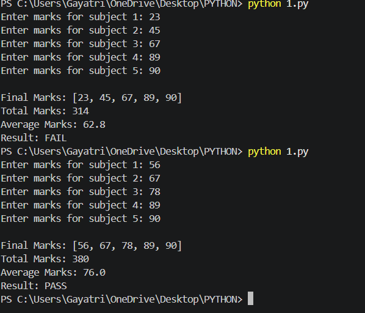
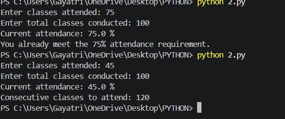
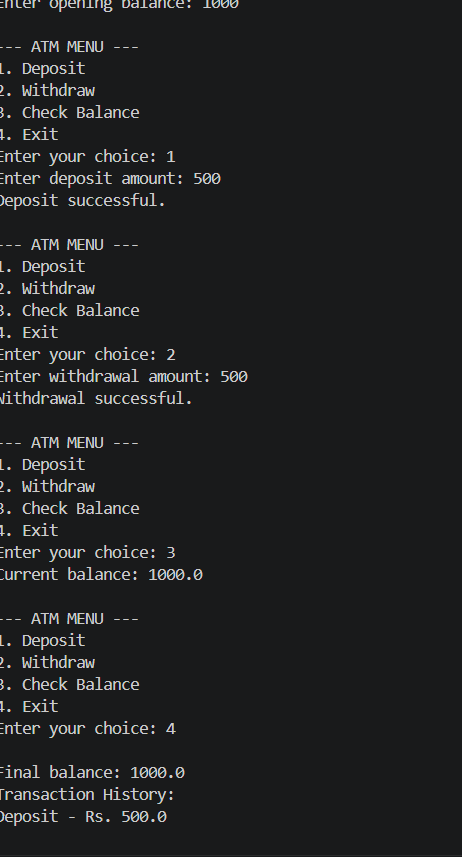
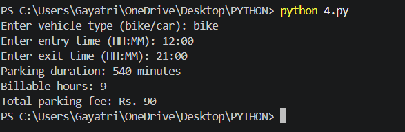
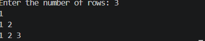
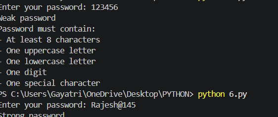
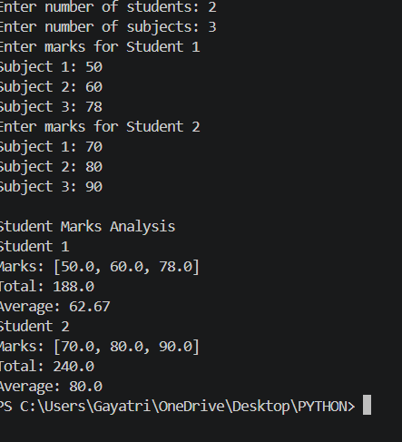
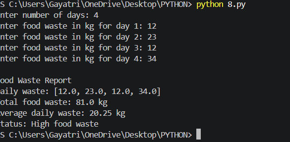
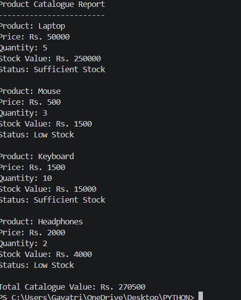
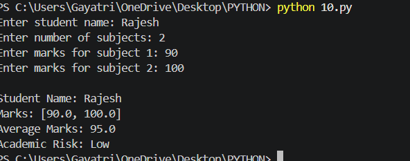

# Python_ASS
Python Activity Based Learning
# PYTHON PROGRAMMING - ABL PROJECTS

## Student Details
**Student Name:** M.Satya Sai Rajesh

**Branch:** CSE (AI & ML)

**Year:** First Year B.Tech

**Section:** 06

**Subject:** Python Programming
**Roll Number:** 26001223

---

### About This Repository
This repository contains 10 Python programs developed as part of Activity Based Learning (ABL). Each program includes source code (.PY file) and its output screenshot (.png file).

---

### List of Programs

#### Program 1: Examination Result and Grace-Mark Validation
**Description:** Calculates students’ total and average marks and checks pass status using a grace-mark rule.
**output Preview:** 
**Source Code:** [View 1.PY](./1.PY)

#### Program 2: Attendance Recovery Computation.
**Description:** Calculates current attendance percentage and the number of additional classes needed to reach 75% attendance
**output Preview:** 
**Source Code:** [View 2.PY](./2.PY)

#### Program 3: ATM Transaction Simulation:
**Description:** Simulates ATM operations such as depositing money, withdrawing money, checking balance, and viewing transaction history
**output Preview:** 
**Source Code:** [View 3.PY](./3.PY)

#### Program 4: Smart Parking Fee Management
**Description:** Calculates parking duration and parking fees based on vehicle type and parking time. 
**output Preview:** 
**Source Code:** [View 4.PY](./4.PY)

#### Program 5:  Numeric Pattern Generator
**Description:** Generates a number pattern using nested loops based on the number of rows entered by the user.
**output Preview:** 
**Source Code:** [View 5.PY](./5.PY)

#### Program 6: Password Policy Validation
**Description:** Checks whether a password satisfies basic security requirements, including uppercase, lowercase, digits, special characters, and minimum length.
**output Preview:** 
**Source Code:** [View 6.PY](./6.PY)

#### Program 7:Student marks Matrix Analysis
**Description:**  A Program stores students’ marks in a nested list and calculates each student’s total and average marks.
**output Preview:** 
**Source Code:** [View 7.PY](./7.PY)

#### Program 8: Food Waste Report System
**Description:** A program to track daily food waste, calculate total waste, average waste and display status (High/Low waste).
**output Preview:** 
**Source Code:** [View 8.PY](./8.PY)

#### Program 9: Product Catalogue Report
**output Preview:** 
**Source Code:** [View 9.PY](./9.PY)

#### Program 10: Inventory Management System
**Description:** A program to display product details like Price, Quantity, Stock Value and Stock Status (Sufficient Stock / Low Stock) as seen in output Laptop, Mouse, Keyboard.
**output Preview:** 
**Source Code:** [View 10.PY](./10.PY)

---

